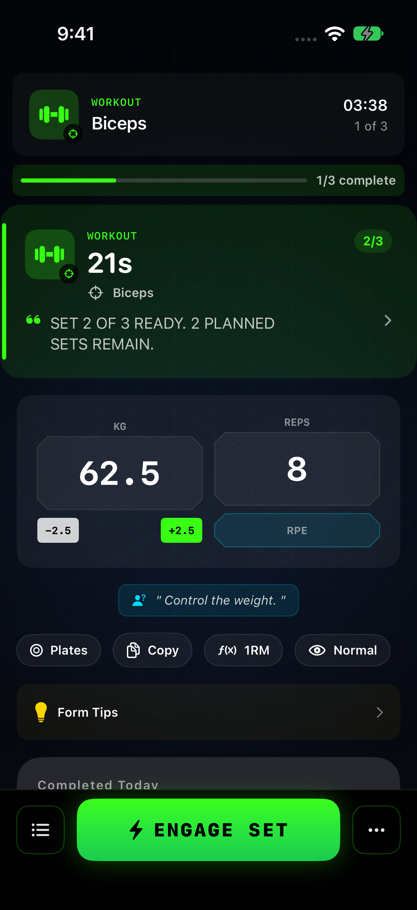
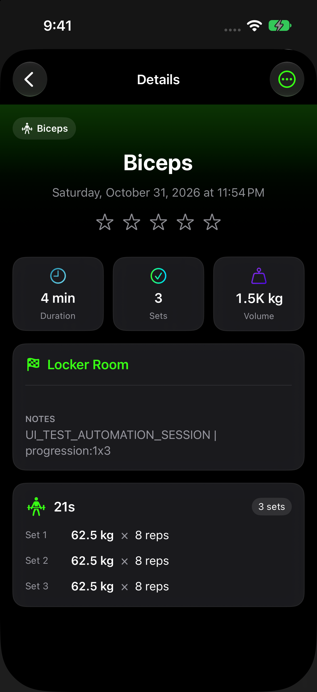
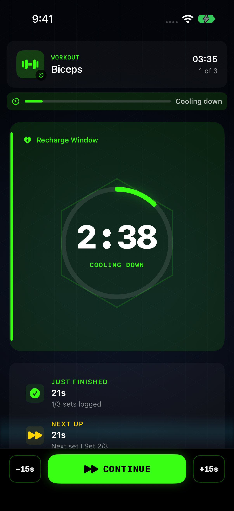
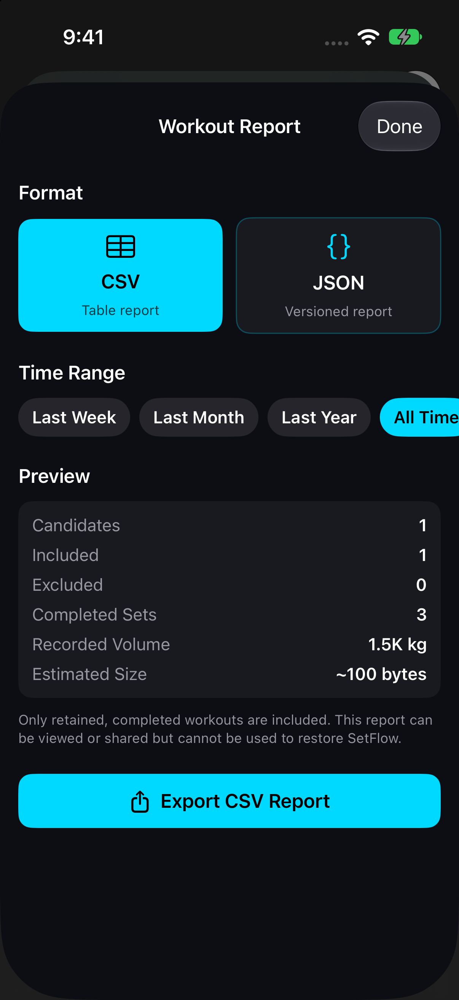
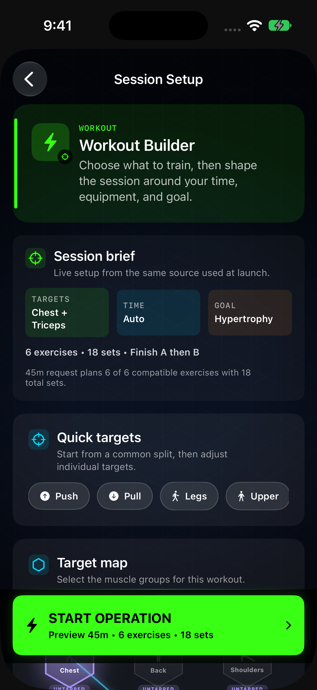
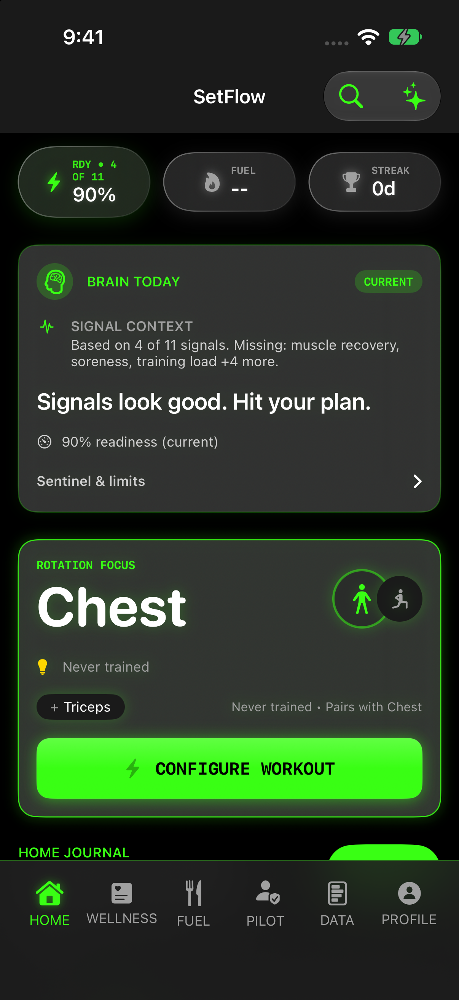
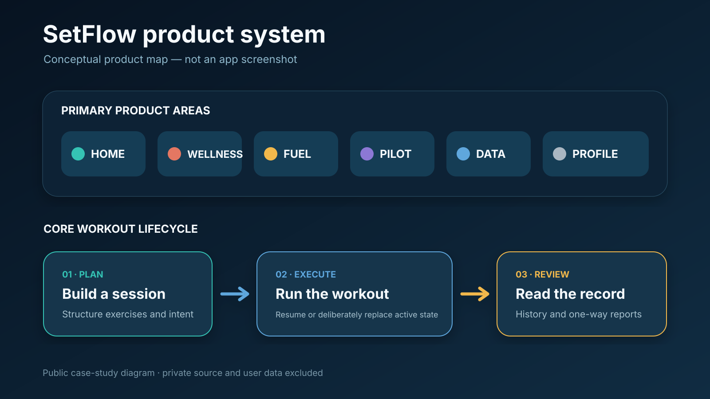
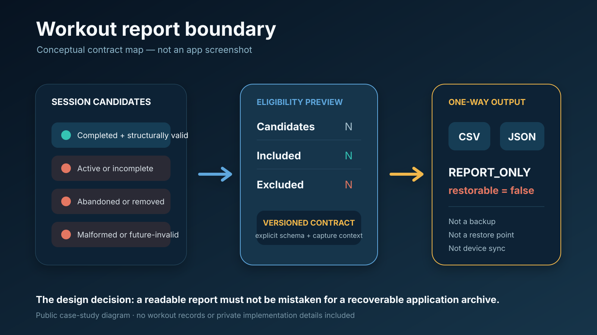

# SetFlow — iOS Strength-Training Product Case Study

A native iPhone product connecting **workout planning, set logging, timed rest,
session recovery and retained training history**. The engineering focus is
keeping the UI and saved workout record consistent when a user enters values,
leaves the app, returns and reviews progress.

**Technology:** Swift · SwiftUI · SwiftData · SceneKit · versioned CSV/JSON reporting.

**My role:** independent product direction and workflow design, with substantial
AI-assisted implementation, debugging, tests and documentation. Most application
code was generated with AI coding agents.

**Status:** private app in development, before beta; no App Store release is
claimed. This public repository is a source-free product case study.

[90-second overview](docs/recruiter_quick_start.md) · [Product decisions](PRODUCT_DECISIONS.md) · [Evidence and limits](EVIDENCE_AND_LIMITATIONS.md) · [Website review](https://setflow-review-nov03.vanshverma0401.chatgpt.site) · [1:34 walkthrough](https://setflow-review-nov03.vanshverma0401.chatgpt.site/watch.html#momentum)

<p>
  
  
</p>

*Native iOS Simulator examples captured October 31, 2026: active logging and
History retained after relaunch. The images use a synthetic three-set fixture;
they do not establish physical-device behavior or release readiness. See the
[capture record](screenshots/README.md) for dates and scenarios.*

## Skills demonstrated

| Skill area | Concrete project evidence |
| --- | --- |
| **Swift, SwiftUI and iOS application state** | Planning → logging → rest → completion → History in the [product journey](docs/product_journey.md) |
| **SwiftData, local persistence and session lifecycle** | Interrupted-session recovery, valid state transitions and persistence-failure handling in [product decisions](PRODUCT_DECISIONS.md#2-keep-workout-state-and-the-resume-interface-aligned) |
| **Input validation, locale-aware parsing and unit conversion** | Supported numeric formats and invalid-value refusal before a set is committed in [the input case](PRODUCT_DECISIONS.md#1-preserve-numeric-meaning-from-entry-to-history) |
| **Data contracts, CSV/JSON reporting and data quality** | Versioned `REPORT_ONLY` exports with eligibility/exclusion rules in [the report boundary](PRODUCT_DECISIONS.md#4-keep-report-scope-explicit) |
| **Product requirements and verification practice** | Workflow decisions, targeted regression guards, dated simulator evidence and explicit remaining gaps in the [feature matrix](docs/public_feature_matrix.md) and [evidence ledger](EVIDENCE_AND_LIMITATIONS.md) |

Source review: October 31, 2026; the latest implementation reviewed includes
changes merged through October 28, 2026, US Central time. The public presentation
was updated November 6, 2026. Earlier native captures remain dated October 31–
November 1, 2026; this README update does not imply a new native execution.

## Interactive website review

[Open the temporary website review](https://setflow-review-nov03.vanshverma0401.chatgpt.site). It presents a 94-second product walkthrough, native screenshots, original workout recordings and searchable feature explanations in an authored 3D website. The website is separate from the native iPhone application. It is shared for feedback, and its registration is a noncollecting simulation; no app download or beta admission is available.

The [94-second walkthrough](https://setflow-review-nov03.vanshverma0401.chatgpt.site/watch.html#momentum) follows 15 features using seven recorded scenes and eight still interface examples captured November 1, 2026. The examples use fictional data and come from separate scenarios, rather than one continuous workout. Full-phone context alternates with focused explanations; the original score is optional and a descriptive transcript is available.

The permanent GitHub case study and its evidence notes remain the primary reference. The review link may be withdrawn after feedback.

## My role and development approach

SetFlow is my independently directed product project. I guide the product
direction and user workflows, using AI coding agents for substantial
implementation, debugging, tests, and documentation. Most application code was
generated with AI assistance.

The walkthrough connects product decisions to implementation evidence and
observed behavior. Detailed contribution and verification boundaries are in the
[evidence ledger](EVIDENCE_AND_LIMITATIONS.md).

## The main user journey

1. **Plan:** choose exercises, muscle targets, equipment, goals, and session
   structure. An existing active workout must be resolved before a new one starts.
2. **Train:** enter weight and repetitions, record sets, and take timed rests.
3. **Continue:** return to an active session with locally retained workout state.
4. **Review:** inspect completed sets, volume, feedback, and personal records in
   History; repeat an earlier workout through the cloning flow.
5. **Use the record:** generate a qualified CSV or JSON workout report for review.

Fresh focused simulator checks demonstrate logging, rest restoration after
relaunch, completion, retained History, and report preview using synthetic data.
The builder and recovery examples use separate scenarios. The
[feature matrix](docs/public_feature_matrix.md) distinguishes these checks from
source inspection, earlier reported results, and remaining gaps.

## Product walkthrough

The [capture index](screenshots/README.md) records the selected native iOS
Simulator images, their capture dates, synthetic-data setup, and what each image
establishes. Screenshots demonstrate the visible states shown; they do not
establish physical-device behavior or release readiness.

The core recording sequence uses one synthetic three-set fixture. The builder,
recovery, and readiness images use separate scenarios described in the index.

| Active logging | Rest retained after relaunch |
|---|---|
|  |  |

| Completed History after relaunch | Qualified report preview |
|---|---|
|  |  |

<details>
<summary>Planning, missing-history, and readiness examples</summary>

| Separate planning preview | Readiness signal coverage |
|---|---|
|  |  |

[Invalid-weight feedback with the set still uncompleted](screenshots/09-input-validation.png).

The current gallery contains seven native PNGs retained from the original
nine-image capture pass.
The earlier body-model rendering and its associated older detail image are
omitted from this revision while their wider-distribution scope is reviewed.
Historical source and license notes remain in [asset attribution](ASSET_ATTRIBUTION.md).

</details>

## Selected capabilities

| Capability | What the system does | Why it matters |
|---|---|---|
| Stateful workout lifecycle | Connects planning, set logging, rest, completion, and retained History | Preserves continuity across a real sequence of user actions |
| Locale-aware numeric input | Accepts supported decimal formats and rejects invalid values before committing a set | Prevents input interpretation from silently changing the saved workout |
| Weight-unit handling | Converts at input and display boundaries while preserving a canonical stored unit | Keeps settings, workout records, and displayed volume consistent |
| Session recovery | Models interrupted-session choices, save failures, retry, and valid status transitions | Protects the meaning of an active or completed workout |
| Training progression | Uses rule-based repetition/load progression and personal-record feedback | Connects earlier recorded work to the next training session |
| Qualified workout reports | Applies eligibility and exclusion rules before generating versioned CSV/JSON | Makes the scope and provenance of a report explicit |
| Local nutrition and hydration | Includes manual records, a journal, and hydration request identities that guard against duplicates | Provides adjacent context with explicit data-quality boundaries |
| Recovery visualization | Includes a mapped 3D body surface, missing-data states, and readiness signal coverage | Makes available evidence and uncertainty visible |

Capabilities have different maturity levels. The table describes implemented
behavior, supported by targeted source review and dated verification records;
it does not claim that every flow is complete or independently re-tested for
this case-study revision.

## Three engineering problems worth discussing

**A valid-looking number can still be interpreted incorrectly.** Recent work
separates numeric parsing from UI state, handles supported locale separators,
and blocks invalid set commits. Unit conversion is applied consistently at
system boundaries. The useful discussion is how an entered value becomes a
saved record and how regressions are detected.

**An interrupted workout needs a deliberate state transition.** Recovery work
addresses stale resume presentation, end-time handling, and changes to already
ended sessions. Targeted tests cover recovery choices and persistence failures.
The useful discussion is the relationship between durable records and the UI
that offers to resume them.

**Missing evidence should remain visible.** Recovery maps distinguish absent
training evidence from a calculated fitness estimate, while readiness presents
how many signals are available. These are rule-based fitness features; the case study claims no
clinical validation or trained-model personalization.

The [decision record](PRODUCT_DECISIONS.md) expands these cases with their
verification scope and limitations.

## Conceptual product maps

The two diagrams are conceptual product maps, not app screenshots. They explain
the workflow and report boundary without publishing application source.



Workout exports carry a versioned `REPORT_ONLY` contract and
`restorable=false`. A report is not a backup and cannot restore the application
database.



## Technology and verification

The application uses Swift, SwiftUI, SwiftData, SceneKit, and HealthKit-facing
data handling. The project includes schema evolution, isolated test stores,
targeted unit/UI tests, credential checks, privacy-manifest checks, and static
release-readiness tooling.

Verification is reported by layer: implementation, author-reported local checks,
GitHub checks that actually executed, visible simulator behavior, and device or
distribution evidence. Recent PRs report local builds and targeted tests. The
previously reviewed private application jobs did not start, so those statuses do not establish executed
CI checks. Capture-specific build and runtime evidence is documented separately
from those earlier reports in the [evidence ledger](EVIDENCE_AND_LIMITATIONS.md).

See [evidence and limitations](EVIDENCE_AND_LIMITATIONS.md) for dated results and
their exclusions. The Python tests in this repository check the public package,
links, file boundaries, and document contracts; they do not test the iOS app.

## Current limits

- SetFlow remains in development; production deployment and release readiness
  are not established.
- Cross-device synchronization is not claimed. Workout reports do not provide
  backup or restore.
- Several nutrition, settings, widget, accessibility, and integration paths
  remain incomplete or need additional verification.
- Health and recovery context is fitness-oriented. No medical advice,
  health-outcome improvement, or clinically validated prediction is claimed.
- AI-assisted development does not imply a deployed LLM, RAG system, fine-tuned
  model, or autonomous coach inside the application.
- The body-model asset has third-party and derivative provenance. Any new
  showcase of that asset must carry the applicable attribution and notices.
- No real-user adoption, revenue, physical-device signoff, or complete security
  certification is claimed.

The public repository contains a source-free case study. Application source,
credentials, user data, and private development records remain private.

## Explore the case study

- [90-second overview](docs/recruiter_quick_start.md)
- [Recruiter summary](docs/recruiter_summary.md)
- [Product journey](docs/product_journey.md)
- [Screenshot dates and scenarios](screenshots/README.md)
- [Product and engineering decisions](PRODUCT_DECISIONS.md)
- [Feature and evidence matrix](docs/public_feature_matrix.md)
- [Evidence and limitations](EVIDENCE_AND_LIMITATIONS.md)
- [Expectations and future direction](docs/product_expectations.md)
- [FAQ](FAQ.md)
- [Public sharing scope](PUBLIC_SHARING_SCOPE.md)
- [Viewing and reuse terms](CASE_STUDY_USAGE.md)

For the public-package checks:

```bash
PYTHONDONTWRITEBYTECODE=1 python3 -m unittest discover -s tests -v
```

[GitHub profile](https://github.com/vanshverma0401-wq)
